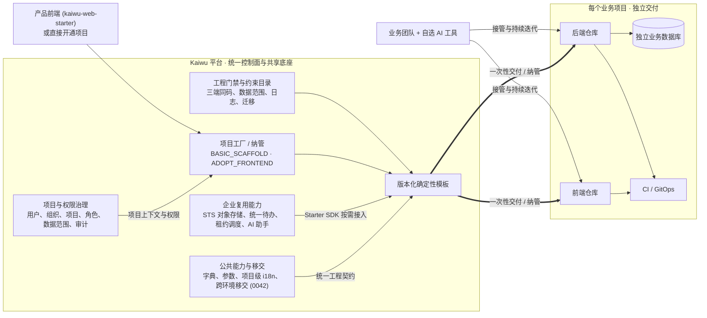
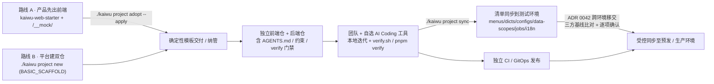
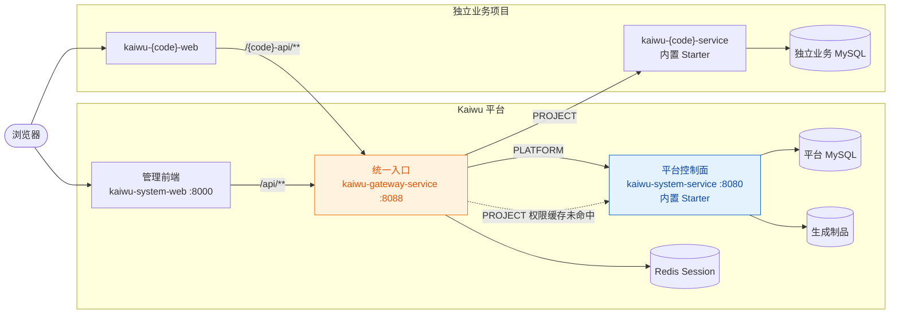
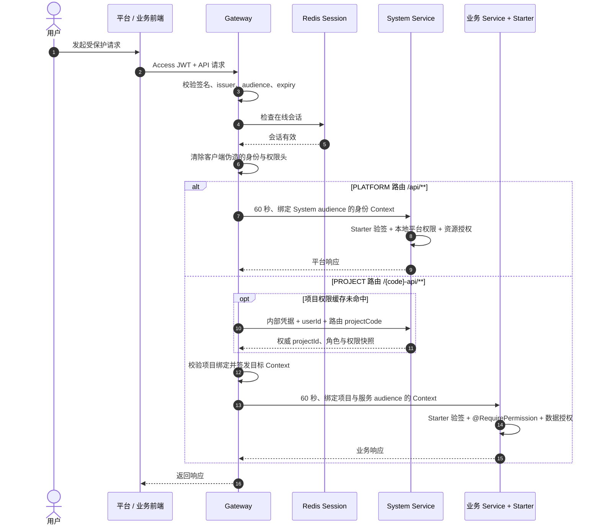
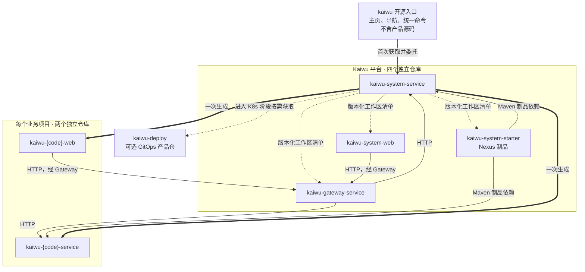
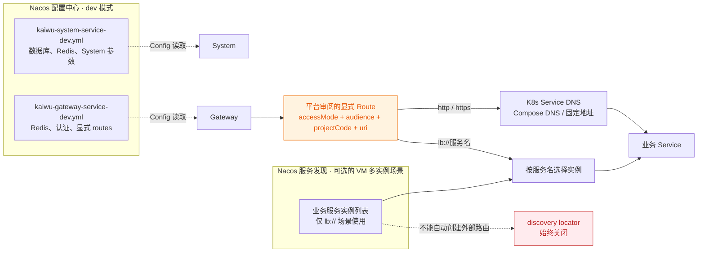

# Kaiwu 架构图谱：从产品原型到独立业务项目

> **Kaiwu 用统一治理和确定性工程，让产品先用 AI 直出前端，再由研发团队以可控门禁和跨环境移交长期演进。**
> 平台本身只做确定性脚手架、前端纳管与企业控制面（[ADR 0038](adr/0038-deterministic-scaffold-and-ai-tool-development.md)、[ADR 0048](adr/0048-adopt-existing-frontend.md)）；业务代码由团队使用任意 AI Coding 工具或常规开发流程在独立仓库迭代。

本文用 7 张图说明 Kaiwu 是什么、为什么这样设计，以及项目如何生成/纳管、跨环境移交、运行鉴权与部署。完整约束以
[`ARCHITECTURE.md`](ARCHITECTURE.md)、[`REQUIREMENTS.md`](REQUIREMENTS.md) 和 [`adr/`](adr/) 为准。

> 希望用更直观的方式阅读？可参考[早期可交互图解](ARCHITECTURE-GUIDE.html)。本文按 v0.3.0 更新，继续作为
> 可评审、可版本化的图文事实源，HTML 用于更适合浏览器的视觉表达。

## 先看结论

> **平台克制，项目自治；产品直出正式前端，模板守住确定性工程；跨环境配置可控移交，代码长期属于团队。**

| Kaiwu 负责什么 | 最终交付什么 |
|---|---|
| 统一治理用户、组织、项目、成员、角色、行级数据范围、菜单、字典、引用式多语言、STS 对象存储、统一待办与审计 | 每个项目从第一天就拥有身份、权限、行级隔离与跨环境配置移交能力，且支持 MySQL 或达梦 DM8 |
| 通过 `project new`（`BASIC_SCAFFOLD`）生成双仓，或通过 `project adopt`（`ADOPT_FRONTEND`）纳管 `kaiwu-web-starter` 产品前端生成配套后端 | 结构一致、自带 `AGENTS.md`、业务规则/场景绑定与校验门禁的独立前后端工程 |
| 通过 Gateway、System 和 Starter 建立统一入口、短期签名 Context 与 SQL 层行级隔离 | 平台事实统一，业务代码和业务数据物理独立，正常业务请求零同步回调 |
| 一次性交付 ZIP 或 CLI `project pull` 取回独立 Git 仓库，随后平台永久退出业务源码写入权 | 独立前端仓、后端仓、业务数据库、仓库清单 `project sync` 与跨环境配置移交链路 |

Kaiwu 不是把业务持续托管在平台中的低代码运行时，也不是在云端替人盲写代码的黑盒 Agent。
它解决的是：**怎样用统一控制面和可执行工程边界，让产品、研发和 AI  Coding 工具安全、长期地交付企业级应用。**

## 图 1：从平台治理到独立业务项目

图的左侧是 Kaiwu 的长期职责：治理平台事实、提供企业共享基础设施与跨环境配置移交。右侧是业务团队的长期职责：
在独立仓库中维护自己的代码、数据和发布节奏。

这里最重要的边界是：**Kaiwu 生成/纳管项目，但不托管项目后续代码演进。** 每个项目只交付一次；生成或纳管完成后平台退出业务仓库写入，后续业务菜单、字典、参数、数据范围、任务与多语言变更通过 `./kaiwu project sync` 和「配置移交」可控对齐。

## Kaiwu 的工程哲学：为什么选择这条路

AI Coding 已经能很快写出页面和接口。真正决定代码能否长期接管的，不是生成速度，而是 AI 能否快速获得
有效上下文、修改时能否遵守跨层与行级隔离契约、多环境上线时配置能否可控对齐，以及换人换模型会不会漂移。
Kaiwu 不替代团队选择的 AI Coding 工具，而是先把这些工程前提放进项目里。

### Kaiwu 的回答

| 工程哲学 | 如何落实 | 形成的优势 |
|---|---|---|
| **平台克制，业务按需生长** | 平台聚焦通用治理、统一入口与 SDK 能力（数据范围、STS 存储、Excel、待办、调度、受控助手），不把具体业务模块强绑进每个项目 | 平台边界清晰；业务项目只引入需要的组件，团队面对聚焦的代码与依赖范围 |
| **治理统一，业务物理独立** | System 维护平台事实（支持 MySQL / 达梦 DM8）；每个项目拥有独立前后端仓、数据库、CI 与 GitOps 路径 | 不重复造身份、权限与存储底座，同时保留项目独立版本化、扩容和回滚能力 |
| **产品即前端，代码为唯一事实源** | 产品可先在 `kaiwu-web-starter` 用 `/__mock/` 完成交互与规则验收，再由 `project adopt` 纳管生成后端并保留同套前端源码 | 消除“画原型 → 重敲前端”浪费，业务逻辑与规则全部留在标准 Git 仓库中 |
| **确定性脚手架 + 本地 AI 迭代** | 平台模板确定性渲染骨架、门禁与 `@/kaiwu` / Starter 接入层；业务功能交给开发者的 AI Coding 工具在本地仓库实现与验证 | 模板可验证、可复现，不受单个云端模型绑定限制，换工具不换架构 |
| **配置随仓同步，跨环境可控移交** | 开发期 `kaiwu/*.yml` 经 `project sync` 增量同步；测试到生产通过 6 类 YAML 快照与三方基线比对（授权/删除/定时任务显式确认）移交 | 告别手写环境同步 SQL，避免主键冲突、误删线上配置或测试任务误跑生产 |
| **显示可以变化，协议必须稳定** | 引用式多语言按项目 `scope_id` 隔离，消除内联 JSON“双真相源”；翻译不改变权限码、状态码、字典值和 Context | 多语言与字典扩展不会制造第二套事实源，不同项目词条互不泄露 |
| **规范必须可以执行** | 权限三端同码、`DataScopeConventionTest`、Flyway、显式字段查询、有界分页、敏感日志、线程与供应链扫描写入本地与 CI 门禁 | AI 漏改在提交前几秒即可暴露，人工评审专注业务逻辑 |

## 图 2：两条交付路径与跨环境闭环

产品团队既可以先在 `kaiwu-web-starter` 无平台直出带规则/场景验收的前端并经 `project adopt` 纳管生成后端，也可以从平台直接 `project new` 起步。两条路线汇入同一套工程约束、权限模型与多环境移交规范。

## 为什么更适合 AI Coding 与企业交付

| 当前 AI 编程与多环境痛点 | Kaiwu 已经提供的机制 | 带来的结果 |
|---|---|---|
| **代码看了一大圈，关键关系仍没进上下文** | 业务代码留在独立项目仓库，平台能力通过 Gateway Context 和 Starter 等稳定契约接入 | 检索范围收敛到当前业务，有限上下文优先用于真正相关的代码 |
| **每次换人或换工具，都要重新解释规矩** | `AGENTS.md`、`CLAUDE.md`、`docs/kaiwu-constraints.json`、业务规则与验收场景随仓库版本化 | 新成员和新的 AI 工具从同一入口开始，支持多种工具薄转发适配 |
| **AI 写了菜单权限，却漏掉行级数据过滤** | Gateway 携带签名 `ds` 声明，`kaiwu-data-scope` 按表在 SQL 层自动拦截，`DataScopeConventionTest` 校验受控表约定，并提示疑似漏声明的接口 | 为已声明的表统一实施功能权限与行级过滤 |
| **页面改完了，接口、权限、菜单或字典漏了一处** | 权限三端同码、`check:dict`、查询上限、显式列投影与敏感日志校验在提交前阻断 | 不一致在本地几秒暴露，无需部署后返工 |
| **AI 把测试配置改好，上线到生产还得重配一遍** | 仓库 `kaiwu/*.yml` 走 `project sync`；跨环境走 **ADR 0042 配置移交包**（三方基线 diff、授权与删除单独勾选、任务默认停用） | 菜单、字典、参数、角色权限与数据范围跨环境可审计对齐 |
| **原型做完要重写，存储与待办都要自建** | `kaiwu-web-starter` 原型同一前端仓直接纳管上线；STS 对象存储、安全 Excel、统一待办开箱接入 | 第一版即具备企业安全与交付基线，不重写前端也不外泄存储密钥 |

## 图 3：平台与业务项目的运行时关系

这张图体现了 Kaiwu 的三个运行时原则：

1. **所有外部 API 都经过 Gateway。** 服务注册不等于对外发布，只有显式登记的路由可以进入。
2. **平台事实与业务数据分离。** System 只访问平台库；每个业务服务只访问自己的业务库。
3. **Starter 是 SDK，不是运行进程。** System 和业务服务都在本地完成 Context 验签与接口权限校验。

AI Provider、GitLab 和 Nacos 是按能力或部署形态启用的外部依赖，不改变核心请求拓扑。生成项目上线前
还需登记服务地址和 Gateway 显式路由，操作步骤见 [`PROJECT_ACCESS.md`](PROJECT_ACCESS.md)。

## 图 4：PLATFORM 与 PROJECT 请求的授权链路

授权职责不是集中在某一个组件，而是有清晰分层：

- Gateway 回答“身份是否可信、会话是否在线、是否允许进入这个项目服务”。
- System 是用户、项目成员、角色、菜单和权限的唯一事实源。
- 目标服务回答“是否拥有接口权限，以及当前数据归属和资源状态是否允许操作”。

外部 JWT 只由 Gateway 接受；目标服务只接受 Gateway 签发、绑定目标 audience 的短期 Context。
无法确定身份、会话或权限时一律失败关闭。完整信任边界见
[`ADR 0003`](adr/0003-gateway-centric-authentication.md) 和
[`ADR 0022`](adr/0022-project-entry-authorization-and-addressing.md)。

## 图 5：仓库边界与长期所有权

`kaiwu` 只是开源发现和命令入口；平台四个运行仓与可选 Deploy 仓仍是独立产品仓，每个业务项目
也固定交付两个独立仓。公开 Release 使用同名 tag 形成兼容单元，但不把源码合并到入口。普通用户
不需要 submodule，产品仓之间也不通过相对路径共享源码；跨仓复用只通过稳定 HTTP 契约或已发布制品。

这种边界带来的直接结果是：平台可以持续演进，业务项目可以按自己的节奏升级 Starter、修改业务代码、
扩容和回滚，两者不会因为共享代码仓库或共享数据库而绑定发布。

## 运行与部署方式一览

| 使用场景 | 入口 | 应用与基础设施 | 配置来源 | Nacos |
|---|---|---|---|---|
| 首次体验、演示、验证发布物 | 在入口仓执行 `./kaiwu up` | 全部由 Docker Compose 管理 | `.kaiwu/dev.env` + `local` profile | 不需要 |
| 日常前后端开发 | 在入口仓执行 `./kaiwu dev` | MySQL/Redis 在 Docker；三个应用为本机进程 | `.kaiwu/dev.env` + `local` profile | 不需要 |
| 验证 Nacos 配置的容器环境 | `./scripts/dev-nacos-run.sh` | 全部由 Docker Compose 管理 | Nacos `dev` Data ID | 只读取配置，服务发现关闭 |
| 接入已有开发基础设施 | `./scripts/kaiwu.sh local-up` | 三个应用为本机进程；MySQL/Redis 由环境提供 | Nacos `dev` Data ID | 只读取配置，服务发现关闭 |
| Kubernetes 部署 | Helm Chart | System/Gateway/Web 为 Pod；生产使用受管 MySQL/Redis | Secret + values + 集群 DNS | 默认不需要 |

这些方式只改变进程在哪里运行、配置从哪里取得、服务如何寻址，不改变
“Web → Gateway → System / 业务 Service”的核心架构。日常开发优先使用 `dev`。

## 图 6：Kubernetes 部署拓扑

```mermaid
flowchart TB
    User(["浏览器"]) -->|"HTTPS"| Ingress["Ingress<br/>可选 TLS 入口"]

    subgraph Chart["Kaiwu Helm Chart"]
        direction LR
        WebSvc["Web Service"] --> WebPods["Web Pod(s)<br/>Nginx + 静态资源"]
        WebPods -->|"/api/**"| GatewaySvc["Gateway Service"]
        GatewaySvc --> GatewayPods["Gateway Pod(s)"]
        GatewayPods -->|"集群 DNS"| SystemSvc["System Service"]
        SystemSvc --> SystemPod["System Pod<br/>默认 1 副本"]
        Flyway["System 启动前<br/>Flyway initContainer"]
        RuntimeSecret["kaiwu-runtime Secret"]
        PVC[("Artifact PVC<br/>ReadWriteOnce")]

        SystemPod --> PVC
        RuntimeSecret -. "运行密钥" .-> GatewayPods
        RuntimeSecret -. "运行密钥" .-> SystemPod
        RuntimeSecret -. "数据库凭据" .-> Flyway
    end

    subgraph Data["部署环境提供"]
        MySQL[("MySQL 8.4<br/>生产使用受管实例")]
        Redis[("高可用 Redis")]
    end

    subgraph Biz["业务项目独立部署"]
        BizSvc["kaiwu-{code}-service<br/>Kubernetes Service"]
        BizPods["业务 Pod(s)"]
        BizDB[("独立业务数据库")]
        BizSvc --> BizPods --> BizDB
    end

    Ingress --> WebSvc
    Flyway -->|"System 启动前迁移"| MySQL
    SystemPod --> MySQL
    SystemPod --> Redis
    GatewayPods --> Redis
    GatewayPods -->|"显式 PROJECT 路由<br/>http://kaiwu-{code}-service:8080"| BizSvc
```

Helm Chart 只管理 Kaiwu 平台的 System、Gateway、Web、Flyway 和制品 PVC；每个业务项目继续拥有
自己的 Deployment、Service、数据库和发布周期。生产环境的 MySQL、Redis、TLS、备份和 Secret
管理由部署平台提供，Chart 内置的单实例 MySQL/Redis 只用于开发或演示集群。

Kubernetes 中使用 Service DNS 完成服务寻址，因此 **Nacos 不是启动前提**。Web 和 Gateway 无状态，
可以增加副本；System 当前使用 ReadWriteOnce 制品 PVC，默认保持一个副本并使用 `Recreate` 更新。
Flyway initContainer 迁移失败时 System 不会启动。完整部署、升级与回滚见
[`KUBERNETES.md`](KUBERNETES.md)。

## 图 7：Nacos 的配置与服务发现边界

Nacos 在 Kaiwu 中有两个彼此独立的用途：

1. **配置中心**：`dev-nacos-run.sh` 与 `local-up` 从两个受保护 Data ID 读取 System/Gateway 配置；
   这两种模式都关闭平台服务的 Nacos 注册与发现。
2. **可选服务发现**：只有 VM 多实例、没有 Kubernetes/Compose DNS 等稳定寻址能力时，业务项目才需要
   自行注册，Gateway 的显式路由才使用 `lb://服务名` 选择实例。

无论是否使用 Nacos，Gateway 都禁止 discovery locator。服务出现在注册中心只说明“实例在哪里”，
不代表“允许从外部访问”；对外发布仍必须由平台生成并审阅包含 `accessMode`、`audience`、
`projectCode` 的显式路由。配置、Secret 和启动细节见 [`NACOS.md`](NACOS.md)。

## 适用边界

Kaiwu 适合希望统一后台项目治理、快速生成第一版工程，并要求业务项目保持独立交付的团队。
如果目标是让模型持续向已有仓库任意写代码、在同一个运行时动态拼装业务模块，或让每个项目自由选择
完全不同的技术栈，则不属于当前阶段的设计范围。

当前固定技术基线为 Spring Boot 4、JDK 21、`@umijs/max`、Ant Design 5 和 ProComponents。
这项约束换来的是模板可验证、工程规则可执行，以及生成项目的一致可维护性。

当前还需要注意三个边界：

- 一个项目成功生成后不会被平台再次生成或自动升级模板，后续演进由业务团队负责。
- 平台会生成完整 Gateway 路由片段，但写入受管路由配置目前仍是人工步骤。
- Kubernetes 中的 System 当前使用 ReadWriteOnce 制品卷，默认保持单副本；Web 和 Gateway 可以独立扩容。

## 图的维护方式

- Mermaid 源码随 Markdown 版本化，GitHub/GitLab 可直接渲染，评审能够看到语义差异。
- `ARCHITECTURE.md` 和 ADR 是架构事实源；本页只负责快速理解，边界变化时先更新 ADR。
- 图中只保留组件、责任和关键关系，异常语义、配置项和实现细节放在正文或专项文档。
- 需要用于汇报时从同一份 Mermaid 导出 SVG/PNG，不在其它绘图工具中维护第二份架构事实。

## 继续阅读

- [`OVERVIEW.md`](OVERVIEW.md)：10 分钟产品与使用概览
- [`QUICKSTART.md`](QUICKSTART.md)：启动平台、生成并运行第一个业务项目
- [`SERVER-DEPLOYMENT.md`](SERVER-DEPLOYMENT.md)：传统服务器部署
- [`KUBERNETES.md`](KUBERNETES.md)：Kubernetes 部署
- [`ARCHITECTURE.md`](ARCHITECTURE.md)：完整架构设计
- [`PROJECT_FACTORY.md`](PROJECT_FACTORY.md)：AI 项目工厂
- [`PROJECT_ACCESS.md`](PROJECT_ACCESS.md)：生成项目对外访问
