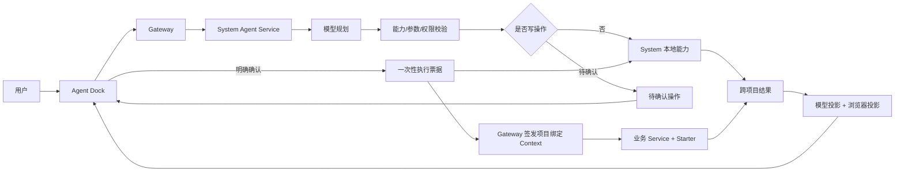

# ADR 0030：跨项目 Agent 能力与受确认操作

- 状态：Proposed（设计复审允许按阶段开发；不代表远程执行或写操作已上线）
- 日期：2026-09-23
- 决策范围：`kaiwu-system-service`、`kaiwu-system-web`、`kaiwu-system-starter` 及生成项目模板
- 前置：ADR 0003、ADR 0006、ADR 0008、ADR 0022

## 背景

当前 Agent 已能跨项目查询项目、生成任务和定时任务，但能力目录只有三条只读能力。项目创建、生成、成员与权限管理、调度配置仍需离开聊天进入页面；业务项目也没有统一的能力注册协议，因此 System 不能安全地代替用户调用某个业务服务。

目标是让聊天成为统一的操作入口，同时保持项目自治、权限事实统一和代码所有权边界：平台可以编排已登记的能力，业务项目决定自己愿意暴露哪些能力，模型不能自行发明接口或执行任意命令。

## 决策摘要

1. 现有 P1a 的“只读 Agent”边界扩展为**受控 Agent Action Runtime**：Agent 可以编排已登记的查询和操作，但不会获得任意代码执行能力。
2. Agent 继续采用“模型规划 → 服务端校验 → 执行 → 双投影”的链路；模型永远不能直接调用 HTTP、SQL、Shell 或 Java 类。
3. 能力分为 **System 本地能力** 和 **业务项目注册能力**。两者使用同一份能力契约、参数校验、结果投影、审计和确认流程。
4. 只读能力可以直接执行；任何写操作必须先生成待确认操作，只有同一用户、同一会话在有效期内明确确认后才能执行。
5. 业务项目通过 Starter 注册固定 Handler。System 只调用已注册且仍在线的能力，不接受任意 URL、类名、脚本或模型返回的文件树。
6. 所有执行继续经过现有权限体系。System 是平台事实源；业务服务仍负责自己的数据归属和最终业务授权。

这里的 Runtime 是能力编排和确认层，不是把模型接入 Shell、代码 Runner 或任意 Workflow。若后续需要执行代码、长流程或自动发布，必须另立 ADR，不能借本 ADR 的能力注册协议绕过边界。

## 目标与边界

### 目标

- 通过聊天完成常用的平台控制面操作：项目、成员、角色、菜单、项目生成和定时任务。
- 通过 Starter 让各业务项目显式注册可查询、可操作的业务能力。
- 让跨项目结果可以聚合展示，并按项目卡片、表格或操作结果渲染。
- 对每次写操作提供可见的目标、参数摘要、影响范围、执行人、过期时间和审计关联号。
- 在权限撤销、项目停用、Handler 离线、参数不合法或目标服务不可达时失败关闭。

### 不在范围内

- 模型直接访问数据库、文件系统、Shell、GitLab、Kubernetes 或任意外部 URL。
- 通过聊天替代业务仓库中的领域规则、事务和审批流程。
- 自动扫描业务服务的所有 HTTP 接口并全部暴露给模型。
- 将业务代码、业务数据或项目仓库重新托管到 System。
- 让 Agent 负责发布中心、工作流引擎或持续修改已交付仓库。

## 能力契约

每条能力必须声明以下字段；缺少任一字段不能进入可见目录：

```json
{
  "projectCode": "crm",
  "code": "crm.record.search",
  "version": "1",
  "description": "查询当前项目可见的客户记录",
  "permission": "crm:record:list",
  "dataScope": "MEMBER_PROJECTS",
  "params": {
    "keyword": { "type": "STRING", "required": false, "maxLength": 100 },
    "status": { "type": "ENUM", "values": ["PENDING", "APPROVED", "REJECTED"] },
    "pageSize": { "type": "INT", "min": 1, "max": 50, "default": 20 }
  },
  "outboundFields": ["id", "title", "status", "createdAt"],
  "redact": {},
  "readOnly": true,
  "idempotent": true,
  "confirmation": "NONE",
  "timeoutMs": 3000
}
```

约束如下：

- `projectCode`、`code`、`version` 由注册方提供，但最终由 System 校验命名空间和版本冲突。
- `permission` 必须同时存在于目标服务的 `@RequirePermission`、菜单 BUTTON 和能力清单中。注册时由 System 按凭据绑定项目查有效 BUTTON 权限，不接受请求体提供的权限白名单；权限码仍使用现有“模块:资源:操作”格式，不要求模块名等于项目码。
- 身份、用户、角色、租户和项目归属字段不能出现在模型可填写的参数中，由 Context 注入。
- `outboundFields` 是送模型的白名单；浏览器卡片可以保留用户有权查看的额外展示字段，但不能把额外字段送给 Provider。
- 写能力必须声明 `idempotent` 和 `confirmation`。默认值是非幂等、需要确认。
- 能力只允许固定参数类型、长度、枚举和页大小；不接受任意 JSONPath、表达式、SQL 或 URL。
- 能力码必须以项目命名空间开头：System 使用 `system.*`，业务项目只能使用 `<projectCode>.*`；注册方不能注册其他项目或 `system.*` 能力。
- `dataScope` 只能使用现有受支持范围 `ALL`、`MEMBER_PROJECTS`、`SELF`，不能由远程项目自定义新的范围字符串。远程 `ALL` 也只描述目标项目内部数据范围，不取消项目绑定。（修订 2026-11-03：[ADR 0044](0044-project-data-scope.md) 增加 `ROLE_SCOPED`，语义为项目内按调用者角色数据范围；读取或写入受控资源的能力应声明它而不是 `ALL`。）
- 远程 manifest 必须与独立注册凭据解析出的项目码一致；仅验证 `projectCode` 与 `code` 相互一致不构成凭据认证。
- 初版限制：项目码 64 字符、能力码 160 字符、版本 16 字符、描述 200 字符、参数最多 32 个、输出字段最多 64 个、调用超时 100–10000 ms。字符串参数最长 4000 字符；整数必须有上下界；枚举最多 100 项、每项最多 128 字符；默认值必须严格符合类型与范围。
- 远程参数不接受 `VISIBLE_PROJECTS` 或模型提供的 `projectId`：跨项目查询拆成各自绑定 Context 的调用。System 本地三条查询的可见项目候选规则保持不变。
- 必填集合可为空但不能缺省；`readOnly`、`idempotent`、`confirmation`、`timeoutMs` 必须显式声明。清单校验成功不设置 `verifiedReadOnly`；现有直接执行入口只接受 `canSkipConfirmation()` 为真的能力。
- 字段名仅支持简单标识符，拒绝表达式与路径；凭据、令牌、私钥和内部地址字段不能送模型。名称检查只是额外防线，不能识别任意别名，仍须审核投影白名单和 Handler 返回值。

## 分层架构



### System 本地能力

第一批只接已有服务方法，不复制 Controller 逻辑：

| 能力组 | 首批操作 | 风险策略 |
|---|---|---|
| 项目 | 创建、编辑、停用/启用 | 创建/编辑需确认；停用需强确认；system 永远拒绝 |
| 成员 | 新增/调整成员、移除成员 | 需确认；保留创建人和当前用户保护 |
| 角色 | 创建、编辑、启停、授权菜单、删除 | 需确认；删除前复用成员引用检查 |
| 项目生成 | 发起、失败重试 | 需确认；复用一项目一次和 owner 校验 |
| 调度 | 创建/编辑、删除 | 需确认；复用成员关系、Handler 在线和 Cron 校验 |
| 交付 | 下载、GitLab 初始推送 | 下载返回页面入口；推送属于高风险，首批只生成待办，不自动执行 |

每项能力调用现有 Service，并传入当前 `KaiwuContext`、`RequestMetadata` 和审计关联号；不通过 HTTP 回调自己的 Controller，也不绕过已有权限注解对应的业务校验。

### 业务项目能力注册

业务服务在启动时通过 Starter 的**独立 Agent 注册凭据**向 System 注册 manifest，并周期性刷新心跳。注册凭据与调度凭据分开，数据库只保存摘要；注册接口只接受凭据绑定的 `projectId`，不接受请求体中的项目身份。System 保存能力版本、权限、参数 schema、在线状态和项目绑定，并在每次使用前检查 manifest 未撤销且心跳未过期。

业务服务必须为每条能力提供固定 Handler：

```java
@KaiwuAgentCapability(
    code = "crm.record.search",
    permission = "crm:record:list",
    readOnly = true)
public class RecordSearchCapability implements AgentCapabilityHandler {
    // 输入已由 Starter 按 manifest 校验；这里仍执行领域级数据归属和状态规则。
}
```

System 不接受业务服务上报的 `readOnly=true` 作为安全证明。只读标记由 Starter 的固定 Handler 类型、注册校验和平台审核共同确定；写能力必须走确认流程。manifest 是不可信注册输入，System 必须限制能力码、描述、参数数量/长度、输出字段、超时和版本格式。

## 跨服务授权

业务操作不能使用 System 的平台 Context 直接访问业务服务。执行流程如下：

1. Agent 请求先在 Gateway 验证外部 JWT、在线会话和 `system:agent:ask`。
2. System 按当前用户的项目成员、角色和能力权限裁剪目录；规划和执行前各复核一次。
3. 需要访问业务项目时，System 向 Gateway 的专用内部 delegation endpoint 请求一次性项目 Context。该请求使用独立的 System→Gateway 服务断言（固定 `sub=kaiwu-system-service`、固定 audience、最长 30 秒），不能复用浏览器 JWT、普通项目凭据或业务服务凭据。
4. Gateway 校验 System 服务断言，再使用当前会话 ID、目标项目和能力码重新读取权威权限快照，校验项目状态和会话有效性后签发 Context。System 只能传递当前 `KaiwuContext.sessionId`，不能传递任意用户 ID 作为身份来源。
5. Context 使用 `typ=kaiwu-agent-action-context+jwt`，绑定一个目标服务 audience、项目 ID、用户 ID、session ID、能力码、correlationId 和 `jti`，有效期不超过 60 秒且只能使用一次。Starter 的 Context 验证器需显式支持此类型，并仅在请求命中已登记的 Agent Handler 时接受；普通业务路由继续只接受现有 `kaiwu-context+jwt`。
6. 业务 Starter 验签、校验项目绑定和能力码，再执行 `@RequirePermission` 与领域数据归属检查。

Gateway 不接受浏览器提交的 delegation claims；System 也不能自行签发业务 Context。delegation endpoint 只允许内部服务调用，不加入 OpenAPI 或前端路由。

## 写操作确认

写操作采用两阶段流程。读操作可以和其他读操作合并；一次确认最多包含一个写能力调用，避免模型把多个修改拼成不可回滚的批次：

1. **预览**：模型计划通过校验后不执行，返回 `pendingAction`，包含能力名称、项目、参数摘要、影响范围、风险级别和 5 分钟过期时间。敏感参数只显示掩码。
2. **确认**：前端显示“确认执行”和“取消”。确认请求调用 `POST /api/agent/actions/{actionId}/confirm`，只携带一次性确认 token；System 在 Redis 中保存 token 摘要、用户 ID、session ID、计划摘要、规范化参数摘要、能力版本和过期时间。Redis 使用 `SETNX` 建立记录、Lua CAS 从 PENDING 原子认领为 EXECUTING，保留终态供查询并禁止重放，token 只在内存响应中出现一次。
3. **执行**：确认时重新查能力、权限、项目状态、成员关系和 Handler 在线状态；任一变化即拒绝并要求重新预览。成功、失败、过期和重复使用都写审计。确认接口本身仍要求 `system:agent:ask`，不能凭 token 越过当前会话权限。

高风险操作（停用项目、删除成员/角色/菜单、轮换凭据、GitLab 初始推送）还需要用户输入明确的确认短语，不能只点击按钮。短语校验绑定 action 的规范化摘要，不接受模型代填。

模型不能生成或修改确认 token；token 不进入模型提示词，不写普通日志，不作为 URL 参数传播。确认 token 不是幂等键；每个 action 另生成服务端 `actionId`，后续需要可重试的本地/远程 Handler 必须将其作为持久化 `idempotencyKey` 传递。B1 项目创建复用既有领域 Service，不增加通用重试：仅保留记录内单次认领，另有项目编码唯一约束；不能据此宣称跨 Redis 故障 exactly-once。

## 失败语义

| 情况 | 行为 |
|---|---|
| 能力不存在、版本冲突或无权限 | 统一返回不可用，不泄露能力是否存在 |
| 参数不符合 schema | 不执行任何能力，返回需要修正的参数说明 |
| 权限/成员在规划后被撤销 | 执行前拒绝，要求重新发起 |
| 项目停用或 Handler 离线 | 拒绝该项目操作，其他独立查询可继续 |
| 远程服务超时 | 单项失败，返回可重试提示；不自动重试非幂等写操作 |
| 远程服务返回业务错误 | 保留安全错误摘要，不把堆栈或内部地址送给模型 |
| 部分能力成功 | 每项结果独立标记，回答明确列出成功与失败，不伪装成整体成功 |
| System/Redis 不可用 | 写操作失败关闭；只读能力按现有降级语义处理 |

非幂等写操作出现“请求已发出但响应未知”时，不自动重放；操作状态标记为 `UNKNOWN`，只提供查询/对账入口。需要重试的 Handler 必须按 `idempotencyKey` 去重，不能依赖 Agent 自己猜测上一次是否成功。

## 前端交互

- Agent 结果继续使用 `capabilityCode` 分流渲染：项目、任务和业务结果使用共享卡片/表格；操作预览使用确认卡片。
- 预览卡片显示项目名称、操作名称、参数摘要、风险等级、过期倒计时和确认/取消按钮。
- 不在模型回答中渲染可执行 Markdown 链接；跳转使用前端已登记的项目入口和能力结果来源。
- 操作成功后展示服务返回的安全摘要，并提供进入对应项目页面的入口；失败后保留重试或返回页面操作的入口。
- 所有文案进入现有 i18n 目录；权限仍使用 `AuthButton` 和后端同码校验。

## 分阶段交付

### Phase A：协议与注册基础

- A1：System 内部 manifest 准入契约与校验，保留平台审核后的只读执行限制；完成安全反例与序列化测试。
- A2 服务端：独立 Agent 注册凭据、持久化目录、注册心跳、撤销及版本审核；已实现的接口与状态规则见 [接入说明](../AGENT_CAPABILITY_REGISTRY.md)。独立 `kagent_` 凭据仅存摘要，项目行锁串行化生命周期操作，首次注册/换版/凭据轮换均需重新审批，离线或已撤销能力不可批准，本阶段只批准只读声明且不加入执行目录。
- A2 客户端及管理页：Starter 已提供独立协议 DTO、显式启用的自动注册/心跳与有界退避，不依赖 System Domain；项目管理页提供一次性凭据、完整清单展示与逐版审批。V48 同步文案、字典和目录修订。仅注册元数据，真实业务项目 SDK 接入联调、远程 Handler 和用户委托仍待后续批次；不能描述为所有子项目已接入或可以执行。
- 此阶段不把远程清单加入模型可用目录，不执行远程 Handler；跨服务委托及实际调用在 Phase C 交付。

后续 HTTP 契约按阶段交付（A1 不创建 HTTP 入口）：

```text
POST /api/internal/agent/capabilities/register   # Phase A2，System 接收注册/刷新 manifest
POST /api/internal/agent/capabilities/heartbeat  # Phase A2，System 接收 Starter 心跳
POST /api/internal/agent/capabilities/{code}/invoke # Phase C，业务 Starter 接收受控调用
POST /api/agent/actions/{actionId}/confirm       # Phase B，System 接收用户确认
```

前三个路径不进入 Gateway 外部 Route，不进入 OpenAPI；注册和心跳使用独立 Agent 注册凭据，invoke 使用 Gateway 签发的 Agent Action Context。内部调用由专用 Gateway 委托链路转发，不在现有浏览器路由上放行内部路径。

### Phase B：System 控制面写操作

- **B1 已实现**：仅项目创建，冻结预览、5 分钟确认/取消、当前会话与权限复核、Redis CAS 单次认领、终态查询及 UNKNOWN 禁止自动重放。结果保留 1 小时；参数、审计、故障与幂等边界见 [项目创建说明](../AGENT_PROJECT_ACTIONS.md)。V49 只新增文案和状态字典。
- B2 后续：以下其余领域写操作、持久化幂等和高风险强确认尚未完成，不因 B1 通过而自动开放。

- 增加确认 token、预览卡片和操作审计。
- 接入项目、成员、角色、菜单、项目生成和调度的安全写能力。
- 完成幂等键、并发修改检测和高风险操作强确认。

### Phase C：业务项目只读能力

- 当前开发实现：System 动态目录、Gateway 专用服务断言/委托、Starter 固定只读 Handler、参数摘要和单次 Context。所有远程开关默认关闭；部署和业务项目接入以最新 HANDOFF 证据为准，不能仅凭实现记录宣称已上线。配置与独立用途密钥决策见 [远程执行说明](../AGENT_REMOTE_EXECUTION.md)。

- Gateway delegation endpoint、Starter 专用 Context 验证与远程调用 Handler，对接 Phase A2 的已审核目录。
- 首先只允许查询类能力，观察超时、权限撤销和跨项目聚合行为。

### Phase D：业务项目写能力

- 待实现协议、事务账本、用途绑定、结果未知恢复与 D1–D4 验收顺序见 [远程写任务设计](../AGENT_REMOTE_ACTIONS.md)。该设计不代表写入口已开放；B1 的 Redis 确认记录不能承担远程事务幂等保证。
- 仅对显式声明幂等、具备领域审计和补偿语义的 Handler 开放。
- 高风险领域操作继续要求强确认或转回业务页面，不做通用“一句话执行所有接口”。

## 验证门禁

后端至少覆盖：

- 未登录、无 Agent 权限、无项目成员关系、项目 ID 伪造和权限撤销后的执行前拒绝。
- confirmation token 过期、重复使用、跨用户、跨会话、跨项目和能力版本变化。
- delegation Context 的签名、类型、issuer、audience、项目绑定、能力绑定和一次性 `jti`。
- System→Gateway 服务断言的固定 subject、audience、有效期、来源和密钥轮换失败关闭。
- manifest 注册凭据不能跨项目使用，能力码不能越过项目命名空间，离线或撤销的 manifest 不能执行。
- Handler 离线、远程超时、幂等重试、部分成功和错误摘要脱敏。
- 非幂等超时不得自动重放；重复 `idempotencyKey` 必须得到同一执行结论或明确的 UNKNOWN。
- 一次确认只能消费一次，确认 token 不能跨用户、会话、项目、能力版本或规范化参数摘要使用。
- 模型投影不包含 `backendUrl`、token、凭据、内部地址或未列入白名单的字段。

前端至少覆盖：

- 预览、确认、取消、过期、失败和重复点击。
- 不同项目结果的卡片来源、权限变化后的隐藏和跳转入口。
- `typecheck`、i18n、权限、架构、格式和构建门禁。

## 迁移与回滚

- Phase A 的目录使用版本化数据库迁移；B1 确认状态使用有 TTL 的 Redis，V49 仅迁移文案/字典。旧客户端仍可查询，但不具备新预览确认界面，应配套升级 Web。
- 新能力按 feature flag 分组，默认关闭远程写能力；可按项目、用户权限和能力码逐步开启。
- 关闭 feature flag 不删除已登记 manifest；未完成的待确认操作全部过期，已执行结果保留审计。
- 任一阶段回滚不影响业务项目已有 API、Starter 普通 Context 或现有调度凭据。

## 未决事项

1. delegation endpoint 的 Gateway 配置项和 System/Gateway 密钥轮换方案。
2. Agent 能力注册凭据是否复用项目凭据表的抽象，还是新增独立 purpose 列。
3. 业务项目能力 manifest 的持久化保留期和审核角色。
4. Phase B 首批已收敛为项目创建 B1；成员/角色/菜单、生成和调度按后续批次逐项评审，远程能力继续先只读后写。


## 参数补充表单（2026-09-25）

- 首批支持 `system.project.create`：规划明确为该能力但缺少参数时，`understood=false` 且保留唯一调用和用户已提供的参数。服务端验证能力、权限与已填参数后返回 `inputForm={capabilityCode,values}`；无权时不返回表单。
- Web 根据受控能力标识选择内置中文表单，不从模型回复解析字段、HTML、校验规则或提交 URL。字段复用创建项目的 DTO 限制。后续能力需明确注册相应表单，未知能力不渲染。
- 表单通过 `/api/agent/ask` 的可选 `input={capabilityCode,values}` 提交；当前仅允许项目创建，服务端重新裁剪权限并校验参数，不让模型重写填写值。结构化输入不是执行确认，也不能选择任意能力。
- 提交成功仅生成既有冻结预览；最终写入仍要求原有会话绑定确认凭据、实时授权、CAS 防重与审计。表单及值只保存在会话组件内存，取消或退出后不持久化。
- `inputForm` 为增量响应字段，旧客户端仍兼容；表单 UI 应在后端 V56 文案及协议部署后发布。


## 聊天内交互边界（2026-09-25）

用户明确要求聊天成为跨项目操作工作区。能力结果中的列表、详情、补参表单、预览和确认应在 Dock 内完成；不得将打开项目管理或业务后台视为该能力的聊天实现。首批项目列表复用现有授权 API 并支持搜索、分页、刷新、详情展示；未接入的写能力仍需逐项实现、授权与确认，不能因统一交互目标放开任意调用。


## 声明式表单增量（2026-09-27）

替代上述“仅项目创建、前端按能力码选择内置表单”的限制：本地能力和远程已审核能力可声明输入表单。当前支持文本、整数、布尔，字段来自能力 schema；远程标题及标签为已审核纯文本。UI 顺序进入清单摘要，旧清单不带扩展时保持原摘要。结构化值不经模型改写或静默钳制，执行仍由原权限、预览和确认守卫控制。详情及未完成范围见 [表单协议](../AGENT-MANIFEST-FORMS.md)。本增量不改变注册、委托 Context 或业务授权边界。


## 表单控件扩展（2026-09-27）

声明式表单支持 ENUM 和 DATETIME。枚举字段附带经审核的受管字典代码，候选值始终来自参数 schema；字典仅提供显示标签。日期沿用无时区 LocalDateTime 契约。旧字段省略新增元数据，旧摘要保持兼容；新清单需逐版审核。权限、写预览确认及执行校验不变，详见 AGENT-MANIFEST-FORMS.md。


## 平台知识与项目信息起草（2026-09-30）

为降低首次上手难度，助手可以回答平台用法问题：知识来自 `kaiwu-system-domain/src/main/resources/agent/platform-knowledge.md`，是随平台版本发布、与代码一起评审的静态只读说明，不做向量检索，也不读取运行时数据。测试校验其中的 `./kaiwu` 命令和文档路径真实存在，避免教错命令。

规划阶段允许模型根据一句话需求为 `system.project.create` 起草项目编码、名称、包名和描述。起草值只进入补参表单交由用户核对修改，仍走原有预览与确认；这不改变其它能力「不猜参数」的规则。
